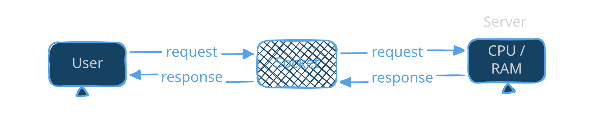

## 1. Synchronization

- It is a technique or a process or a method or a way that\
  is responsible for avoiding conflict between processes when\
  they are sharing data, resources and so on we use this\
  syncrhonization to avoid any deadlock or conflict or anything\
  else.
- The main task is to avoid conflicts.
- We have different tools to do syncrhonization which are:

## 2. Semaphores

- It is a synchronization tool that is used to control access\
  to shared resources by multiple processes or threads.
- It uses a counter to manage resource access.
- It helps coordinate multiple processes.
- It prevents race conditions.
- It uses two operations which are:
  - Wait(): Whenever a process is told to wait and so other\
    resource is using it.
  - Singal(): WHenever a process can access the resources

## 3. Mutex Locks

- The word mutex is taken from two words which are mutual exclusion:
  - These are the hardware that is used by one process at a time like printer which\
    can be used by one laptop at a time.
  - Mutual means two
- Mutex Lock means that at the same time when multiple processes try to use the\
  same shared resource like printer.
  - If there is no mutex lock in printer as it receives multiple requests it will print\
    those pages in random order like print a page from one user and the the other page\
    from the other user.
  - If there is a mutex lock then that means that the printer can only be used by\
    only one device at a time which will lead to reliable printing of requests.
- Mutex lock is a locking mechanism that allow only one process or thread at a time.
- Only one thread or process can hold a mutex lock at a time.
- A thread must lock before entering the critical section.
  - when one process is holding or using the resource
- It prevents data inconsistency and conflicts.

## 4. Interprocess Communication (IPC)

- It is a mechanism that allows processes to communicate and share data with each\
  other in OS.
- In other words it is a mechanisms allow process other processes within (inside) the\
  same computer.
  

- In a multi-process system, processes often need to share information, synchronize\
   their actions, or communicate with each other to perform taks.
- IPC provides the means for these interactions.

Example:

As shown in example the same picture can be used by two independent processes\
without any problem this is possible through IPC.

## 5. Why is synchronization important?

- Process Independence: Each process runs independently but many tasks require them\
  to cooperate and share data.
- Concurrency: IPC is crucial for processes running concurrently on a CPU, as it allows\
  them to communicate without interfering with one another.
- Synchronization: IPC helps synchronize processes, ensuring that they can access\
  shared resources without causing conflicts or inconsistencies.

## 6. Types of process:

### 1. Independent Process:

- Independent process are those processes which is not affected by other process or\
  affect other process.
- It's execution do not need other process to complete it's task.

### 2. Cooperative Process

- Those process which affect or affected by other processes
- It can not complete it task without other process data or support.

Example:

- Cooperative process: A media player needs data to read or play from
- Independent process: Like notepad which does not need any other process to\
  execute it is only responsible for text reading and writing.

## 7. Types of inter-process communication

### 1. message passing:

- it is a type of communication
- the message passing has 2 things (Data, Control information)
- Kernel is responsible for sharing data
- it has 2 types

1\. direct message passing:

\- The recepeints are known

2\. indirect message passing:

\- The recepient is unknown

### 2. shared memory:

- it is a type of IPC
- where processes do communication in a shared location
- the processes can read/write on that shared location
- The kernel plays no role in this communication

### 3. LPC (Local Procedure Call)

- It can be accessed within the same computer
- Whenever an app needs the help of another process to complete the task it calls\
  that process through the LPC
- It is a mechanism that allows a process to raise a function call to another process\
  to do the task for itself.
- The local procedure call only be called within the same computer

### RPC (Remote Procedure Call)

- The RPC is another method of communication where the process raise a function call\
  to another process which is not in same computer.
- The task completion depend on other computer's process.\
  how are you nigga what the hell is wrong with you

### Sockets:

- It is communication endpoint.
- It is used to send or receive data either in same network or over a network.
- It allows applications to exchange information seamlessly.
- Socket is combination of IP + Port Number like: 192.168.1.1:80.

